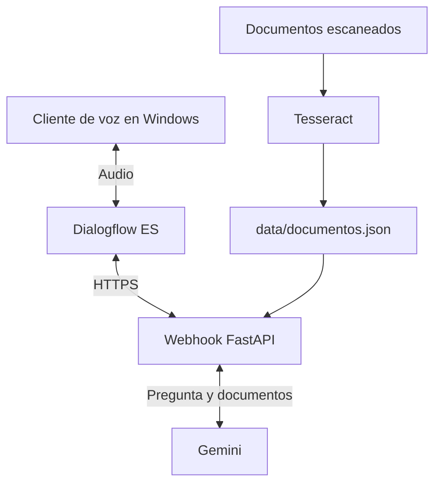

# Asistente de voz del Gimnasio Atlas

Proyecto de IA Clásica de Carlos Fernández.

Asistente para un gimnasio ficticio. Permite reservar clases, consultar horarios y preguntar por las normas, tarifas y rutinas de entrenamiento.

Para reservar, pide clase, fecha, hora y DNI. Comprueba el DNI, la cuota y las plazas antes de pedir confirmación. Si la sesión no está disponible, propone otra cercana.

## Cómo funciona



Dialogflow transcribe la voz, reconoce la intención y devuelve la respuesta hablada. El webhook comprueba las reservas y consulta los documentos con Gemini.

El OCR se ejecuta por separado. El webhook lee el resultado al arrancar para no procesar imágenes durante la conversación.

## Archivos principales

| Ruta | Contenido |
|---|---|
| `dialogflow/agent/` | Intenciones, entidades y configuración del agente |
| `dialogflow/export/CarlosFernandezAgent.zip` | Agente listo para importar |
| `dialogflow/build_zip.py` | Genera un ZIP a partir de los JSON del agente |
| `ocr/documentos/` | Imágenes agrupadas por documento |
| `ocr/ocr.py` | Extrae texto y valida campos con expresiones regulares |
| `data/documentos.json` | Texto reconocido, campos y avisos del OCR |
| `webhook/` | Reservas, horarios y consultas documentales ([detalle](webhook/README.md)) |
| `voz/cliente_voz.py` | Graba el micrófono y reproduce la respuesta |

## Conversación

El agente permite reservar, confirmar, cancelar y corregir el DNI sin empezar de nuevo. También responde a consultas de horarios y documentos, saluda y se despide. Las preguntas que no reconoce se consultan en los documentos.

Las clases son yoga, pilates, spinning, zumba, body pump y HIIT. La entidad `@clase` admite sinónimos como «ciclo indoor». `@dni` acepta puntos, espacios y guiones; el webhook limpia el valor y comprueba la letra. Las fechas y horas usan `@sys.date` y `@sys.time`.

## Decisiones del código

- **Reservas:** los datos son simulados. La sesión propuesta se guarda en el contexto de Dialogflow y las plazas se comprueban otra vez al confirmar.
- **OCR:** las imágenes se amplían al doble y se eliminan los bordes de las tablas para mejorar la lectura. Los títulos con fondo oscuro se procesan aparte. `--psm 4` conserva mejor las filas.
- **Campos extraídos:** las expresiones regulares buscan importes, fechas, horas, artículos, leyes, edades y ejercicios. Los valores dudosos quedan en `avisos` para revisarlos.
- **Documentos:** los cuatro textos caben en cada consulta a Gemini. El modelo recibe instrucciones de usar solo esa información y devolver `NO_ENCONTRADO` si falta la respuesta.
- **Tiempo de respuesta:** se usa `gemini-3.1-flash-lite` y una llamada inicial en segundo plano para reducir la espera. El cliente limita la espera de red a 3,5 s por operación; no es un límite total. Si la consulta falla, el asistente avisa.
- **Voz:** las respuestas son breves. SSML añade pausas y deletrea el DNI y el código de reserva. Las fechas y horas se escriben en palabras para que suenen naturales.

## Puesta en marcha

### Requisitos

- Python 3.11 en WSL/Linux para el webhook y el OCR.
- Python 3.10 o posterior en Windows para usar el micrófono.
- Un agente de Dialogflow ES y una clave JSON de una cuenta de servicio con el rol **Dialogflow API Client**.
- Una clave de Gemini de [AI Studio](https://aistudio.google.com/apikey) para consultar documentos.
- [cloudflared](https://github.com/cloudflare/cloudflared/releases) para exponer el webhook.
- Tesseract 5 con español (`spa`), solo si quieres repetir el OCR.

### Configuración

```bash
cp .env.example .env
```

Rellena `GOOGLE_API_KEY` y `DIALOGFLOW_PROJECT_ID`. Guarda la clave JSON en `credenciales/`. Esa carpeta y `.env` están excluidos de Git.

### Webhook (WSL/Linux)

```bash
cd webhook
python3 -m venv .venv
source .venv/bin/activate
pip install -r requirements.txt
uvicorn main:app --port 8000
```

Abre `http://localhost:8000/`: debe mostrar `"documentos_cargados": 4`.

### Túnel público

En otra terminal:

```bash
cloudflared tunnel --url http://localhost:8000
```

Copia la URL `https://<palabras>.trycloudflare.com`. Cambia cada vez que arrancas el túnel.

### Agente de Dialogflow

1. Crea un agente ES en español con zona horaria `Europe/Madrid`.
2. En **Settings → Export and Import → Restore from ZIP**, importa el ZIP de `dialogflow/export/`.
3. En **Fulfillment → Webhook**, pon la URL del túnel seguida de `/webhook`.
4. En **Settings → Speech**, activa **Automatic Text to Speech** y elige una voz `es-ES`. Este ajuste se hace a mano; no va en el ZIP.

Si editas los JSON del agente, genera otro ZIP desde la raíz:

```bash
python dialogflow/build_zip.py --webhook-url https://<palabras>.trycloudflare.com/webhook
```

El resultado queda en `dialogflow/dist/agente_gimnasio.zip`.

### Cliente de voz (Windows, PowerShell)

Define la ruta de la clave:

```powershell
setx GOOGLE_APPLICATION_CREDENTIALS "C:\ruta\a\la\clave.json"
```

Abre una terminal nueva y, desde el proyecto, ejecuta:

```powershell
cd voz
python -m venv .venv
.venv\Scripts\activate
pip install -r requirements.txt
python cliente_voz.py
```

Pulsa Enter para empezar a hablar y otra vez para terminar. También puedes escribir una frase. Usa `q` para salir. La consola muestra la transcripción, la intención y el tiempo de respuesta.

### Repetir el OCR

El resultado ya está en `data/documentos.json`. Para regenerarlo, activa el entorno del webhook y ejecuta desde la raíz:

```bash
pip install -r ocr/requirements.txt
python ocr/ocr.py
```

## Pruebas y limitaciones

Desde `webhook/`, con el servidor arrancado, ejecuta `python pruebas/probar.py` para enviar las 20 peticiones de ejemplo. `python pruebas/bateria_documental.py` comprueba diez preguntas al modelo sin necesitar el servidor. Los resultados esperados están en el [README del webhook](webhook/README.md).

- Las reservas se guardan en memoria y se pierden al reiniciar.
- Las peticiones de prueba usan fechas de noviembre de 2026; habrá que actualizarlas cuando pasen.
- El OCR puede perder comas en los precios o separar un importe de su concepto. Revisa los avisos y las imágenes originales si necesitas confirmar un dato.
- Las instrucciones al modelo reducen las respuestas inventadas, pero no garantizan que todas sean correctas.
